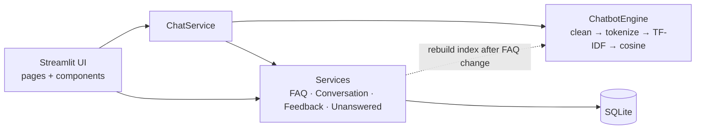
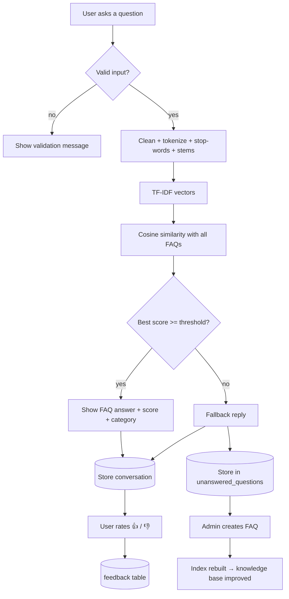
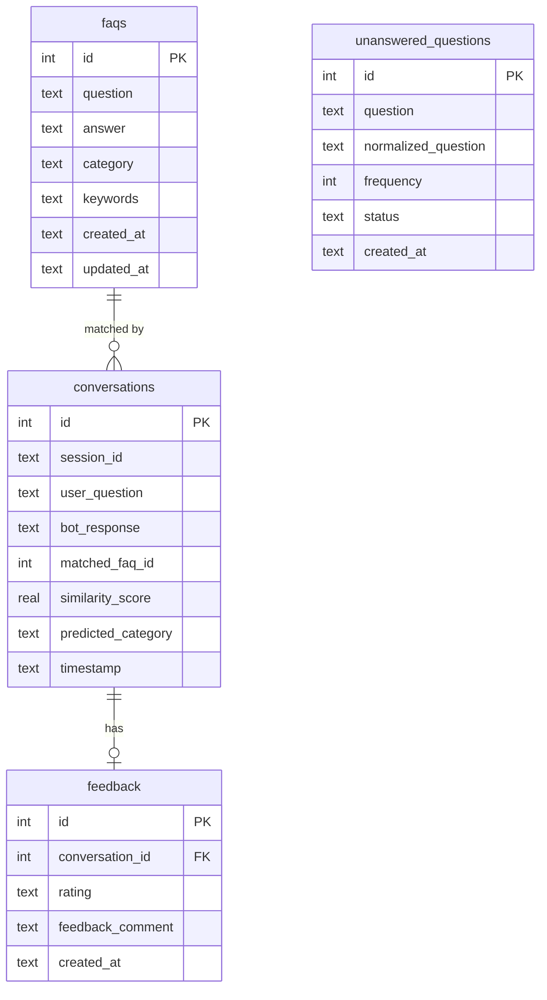

# ✨ QueryLens AI – Intelligent FAQ Chatbot

> **Artificial Intelligence Internship Project – Task: "Chatbot for FAQs"**
> An NLP-powered FAQ assistant that understands differently-worded questions using **TF-IDF + cosine similarity**, explains *why* it chose an answer, and refuses to guess when it is not confident.

This is an internship learning/portfolio project and carries no official endorsement beyond the internship assignment. The bundled FAQ data is for a **fictional "Nova University"** – fees, dates and rules in it are illustrative.

## Screenshots

| Chatbot | Dashboard |
|---|---|
|  |  |
| **NLP Insights** | **FAQ Knowledge Base** |
|  |  |

## Problem statement
Students ask the same questions again and again (admission, fees, exams, hostel…). Answering them manually is slow, and a keyword-only bot breaks as soon as a user words a question differently. QueryLens AI retrieves the most relevant FAQ using similarity-based NLP, shows a confidence score, and records everything it could *not* answer so the knowledge base improves over time.

## Objectives
- Understand a user question and match it with the most relevant stored FAQ.
- Demonstrate text cleaning, tokenization, stop-word removal, TF-IDF and cosine similarity.
- Never force an answer when the similarity score is too low (configurable threshold).
- Make the AI explainable (NLP Insights page) and measurable (dashboard from real data).
- Keep the architecture modular so an LLM or sentence embeddings can be added later.

## Features
| Area | What you get |
|---|---|
| **Chatbot** | Chat bubbles, typing indicator, timestamps, suggested questions, clear conversation, 👍/👎 feedback with comment, per-answer NLP details |
| **Dashboard** | 8 statistic cards + 6 interactive Plotly charts (activity line with daily/weekly/monthly filter, category donut, top-10 FAQs, success-rate donut, similarity histogram, feedback & category bars) – **all computed from real database records, empty states instead of fake numbers** |
| **FAQ Knowledge Base** | Browse, search, filter by category, add, edit, delete, safe CSV import, most-asked FAQs |
| **NLP Insights** | Live pipeline demo: cleaned text, tokens, stems, TF-IDF weights, top candidates, scores, predicted category, keyword-vs-similarity comparison |
| **Conversation History** | Search, filter, view, delete, export CSV |
| **Unanswered Questions** | Repeat counter, admin review, *create FAQ from question*, mark resolved |
| **Feedback Analytics** | Helpful / not helpful / no feedback, FAQs needing human review (answers are **never** auto-edited) |
| **Security** | Admin password for editing/review pages, input validation, HTML escaping, parameterised SQL, upload limits, no hard-coded paths/credentials |

50 sample FAQs across 10 categories: Admissions, Courses, Fees, Examinations, Attendance, Scholarships, Placements, Hostel, Library, Technical Support.

## Technology stack
Python 3.10+ · Streamlit · NLTK (tokenizer) · scikit-learn (TF-IDF, cosine similarity) · Pandas · SQLite · Plotly · custom CSS

## NLP workflow
```
Input → Cleaning → Tokenization → Stop-word removal → Stemming → TF-IDF → Cosine similarity → Threshold → FAQ retrieval → Response
```
1. **Cleaning** – lower-case, strip URLs/punctuation/special characters, collapse whitespace.
2. **Tokenization** – NLTK `RegexpTokenizer`.
3. **Stop-words** – common words removed (negations kept).
4. **Stemming** – small rule-based stemmer (`fees→fee`, `applying/applied→appli`).
5. **TF-IDF** – every FAQ document (question + keywords) is vectorised at **word level** and **character 3-5-gram level** (the latter tolerates spelling mistakes).
6. **Cosine similarity** – query vs. every FAQ; `score = max(0.6·word + 0.4·char, 0.85·char)`.
7. **Threshold** (default `0.35`, adjustable in the sidebar) – below it the bot shows a fallback and stores the question as *unanswered*.
8. **Intent** – the category of the best match.

**Example** – stored FAQ: *"How can I apply for admission?"*
User: *"I want to know the admission application process."* → matched (score ≈ 0.6) although the wording differs; *"adimssion aplication procces"* (typos) is also matched; *"What is the weather like today?"* is rejected (score ≈ 0.08).

### Honest limitation: lexical, not semantic
TF-IDF + cosine similarity compares **words/characters, not meaning**. A paraphrase that shares no vocabulary (*"How do I enrol?"*) can be missed. The engine (`nlp/chatbot_engine.py`) is isolated, so sentence embeddings (e.g. `sentence-transformers`) or an LLM can replace the retriever later without touching the UI.

## System architecture


## Data flow


## Database structure (SQLite)

Two small additions to the brief's schema: `conversations.predicted_category` (detected intent) and `unanswered_questions.normalized_question` (counts repeated questions). `matched_faq_id` is `NULL` when a question was not answered. It is intentionally *not* a foreign key, so deleting an FAQ never rewrites history.

## Project structure
```
QueryLens-AI/
├── app.py                  # entry point + navigation
├── config.py  errors.py    # settings (env-overridable) + exceptions
├── pages/                  # 8 Streamlit pages
├── nlp/                    # preprocessing, tokenizer, vectorizer, similarity, chatbot_engine
├── database/               # schema.py, db_manager.py
├── services/               # faq / conversation / feedback / unanswered / chat / analytics
├── components/             # sidebar, chat_interface, dashboard_cards, charts
├── data/                   # sample_faqs.json (+ build_sample_faqs.py)
├── assets/                 # logo.png, styles.css
├── tests/                  # unit tests (55)
└── .streamlit/config.toml  # theme
```

## Installation
```bash
git clone https://github.com/<your-username>/QueryLens-AI.git
cd QueryLens-AI
python -m venv .venv
source .venv/bin/activate        # Windows: .venv\Scripts\activate
pip install -r requirements.txt
```

## Run
```bash
streamlit run app.py
```
Open http://localhost:8501. On first start the database (`data/querylens.db`) is created and seeded with the 50 sample FAQs.
Optional environment variables: `QUERYLENS_DB_PATH`, `QUERYLENS_THRESHOLD`, `QUERYLENS_TIMEZONE` (default `Asia/Kolkata`; timestamps are stored in UTC).
Light/Dark theme: ⋮ menu → Settings → Theme.

## Admin password
Chatting, the dashboard, NLP Insights and browsing FAQs are public. **Adding/editing/deleting/importing FAQs, Conversation History and Unanswered Questions require the admin password**, which is never stored in the code. Without a configured password these features stay locked.
- **Locally:** copy `.streamlit/secrets.toml.example` to `.streamlit/secrets.toml` and set `ADMIN_PASSWORD`, or set the environment variable `QUERYLENS_ADMIN_PASSWORD`.
- **Streamlit Cloud:** App → Settings → Secrets → add `ADMIN_PASSWORD = "your-password"`.

## Testing
```bash
python -m unittest discover -s tests -t . -v     # or: pip install -r requirements-dev.txt && pytest
```
55 automated tests cover: exact question, different wording, spelling mistakes, extra spaces, capitalisation, unrelated question, empty question, FAQ add/edit/delete, conversation history, helpful / not-helpful feedback, unanswered storage (and repeat counting), dashboard statistics, similarity score calculation, threshold validation, CSV-import safety.

## Limitations
- Lexical matching only (see above); English only.
- Sample data is fictional and small (50 FAQs).
- Admin protection is a single shared password (fine for a demo; use real user accounts for production).
- SQLite on free cloud hosting may not persist between restarts.

## Future improvements
Sentence-embedding retriever · optional LLM answer rewriting · admin authentication · multilingual FAQs · hosted database (PostgreSQL) · voice input.

## Deployment note (optional)
`app.py` is the entry point and `requirements.txt` is complete, so it can be deployed on Streamlit Community Cloud. Use a hosted database if long-term conversation history is needed.
